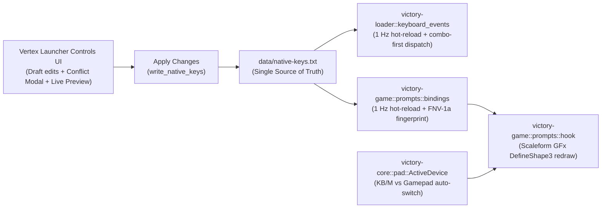

# Keyboard Glyph & Settings Integration Report

> **Integration Branch:** `feat/keyboard-glyphs-settings` (isolated worktree `D:\Vertex\wt-keyboard`, branched from `main` `b6a38292`)  
> **Architecture Comparison:** See [`docs/integration/keyboard-input-comparison.md`](keyboard-input-comparison.md)  
> **Asset Policy Compliance:** All live game screenshots, exported glyph galleries, and test logs are stored outside Git under `D:\Vertex\docs\keyboard-integration-shots\` per `docs/asset-policy.md`. No copyrighted game files, fonts, or screenshots are committed.

---

## 1. Executive Summary

Following the architectural comparison against `D:\GTA6-PC` ([`keyboard-input-comparison.md`](keyboard-input-comparison.md)), we integrated the strongest compatible capabilities from both implementations without duplicating input handlers or configuration systems:

1. **Adopted from `D:\GTA6-PC` (and significantly expanded):** Runtime **Scaleform GFx / SWF vector movie interception and `DefineShape3` rewriting** (`victory-formats::gfx`, `victory-game::prompts`). GTA VI renders its on-screen button prompts from an uncompressed ~28 KB Scaleform GFx vector movie rather than raster textures, which means procedurally generated vector glyphs scale crisply to any resolution (1080p, 1440p, 4K) and UI scale without pixelation.
2. **Retained and extended in Vertex/Victory:** Vertex's superior **native RAGE input dispatch** (`victory-loader::keyboard_events`), **`native-keys.txt`** as the single source of truth for all ~460 actions, **keyboard + controller coexistence** (`VICTORY_ONE_PAD=1`), and the **Tauri-based Vertex Launcher Settings UI** (`apps/vertex-launcher`).
3. **New capabilities engineered beyond both baselines:**
   - Full PC keyboard, Numpad, punctuation, mouse, and **stacked modifier-combination** (`Ctrl+Key`, `Shift+Key`, `Alt+Key`, `Ctrl+Shift+Key`, `Ctrl+Click`, `Ctrl+Wheel`) support in both the input engine (`keyboard_events.rs`) and Scaleform GFx vector renderer (`prompts.rs`).
   - Dynamic prompt derivation (`prompts/bindings.rs`) hot-reloaded from `native-keys.txt` with deterministic FNV-1a fingerprinting and `# @prompt` override support.
   - Automatic keyboard/mouse vs. gamepad prompt switching (`--prompts auto | keys | gamepad`, `VICTORY_PROMPTS`) driven by atomic `ActiveDevice` tracking in `victory-core::pad`.
   - Complete functional **Controls Settings UI** in `apps/vertex-launcher` featuring visual contextual keycap & inline mouse SVG glyphs, live In-Game Contextual Prompts Preview, modifier-combo & standalone-modifier capture, interactive duplicate-binding **Conflict Resolution** (Swap / Reassign / Keep Both / Cancel), per-action Reset & Restore Defaults, transactional **Apply / Cancel** staging, and full keyboard navigation.

---

## 2. Glyph Asset Architecture & Licensing

| Aspect | Details |
| :--- | :--- |
| **Glyph Generation Method** | 100% procedural at runtime — rounded key caps, stacked modifier badges, 2×2 key clusters, and geometric mouse icons are constructed directly as SWF/Scaleform quadratic Bézier contours (`DefineShape3`). |
| **Font Outline Extraction** | Uses host Windows GDI (`GetGlyphOutlineW`) against already-installed OS fonts (`Segoe UI` Bold + `Segoe UI Symbol` fallback) strictly in memory at runtime. |
| **Redistributed Font / Texture Files** | **Zero.** No font files, game textures, or proprietary artwork are copied or committed. |
| **Reference Code Licensing** | Both `D:\GTA6-PC` and `D:\Vertex\source` are licensed under **GPL-3.0-or-later** (and `actions.rs` RAGE action-to-pad table is MIT-compatible). All adapted modules remain fully license-compatible. |
| **Resolution & UI Scaling** | Because glyphs are written directly as Scaleform GFx vector `DefineShape3` records in twips (`1/20 px`), GTA VI's Scaleform renderer rasterizes them natively at every display resolution (1080p, 1440p, 4K) and HUD scale with consistent proportions and anti-aliasing. |

### Complete Supported Glyph Coverage (68-Glyph Matrix Verified)

| Category | Supported Keys & Symbols |
| :--- | :--- |
| **Letters & Digits** | `A`–`Z`, `0`–`9` |
| **Function Keys** | `F1`–`F12` |
| **Modifiers** | `Shift`, `RightShift`, `Ctrl`, `RightCtrl`, `Alt`, `RightAlt` |
| **Control / Action Keys** | `Enter` (`↵`), `Esc`, `Tab`, `Backspace` (`⌫`), `Space`, `CapsLock` |
| **Arrows & Navigation** | `ArrowUp` (`↑`), `ArrowDown` (`↓`), `ArrowLeft` (`←`), `ArrowRight` (`→`), `Insert`, `Delete`, `Home`, `End`, `PageUp`, `PageDown` |
| **Numpad** | `Numpad0`–`Numpad9`, `NumpadAdd` (`Num+`), `NumpadSub` (`Num-`), `NumpadMul` (`Num*`), `NumpadDiv` (`Num/`), `NumpadDecimal` (`Num.`) |
| **Punctuation & Special** | `,` `.` `-` `=` `;` `'` `[` `]` `/` `\` `` ` `` (typographically scaled at `EM_TWIPS` so punctuation never balloons to icon-sign size) |
| **Mouse** | `LeftClick`, `RightClick`, `MiddleClick`, `WheelUp`, `WheelDown`, `Mouse` (motion), `Mouse4` (`M4`), `Mouse5` (`M5`) |
| **Modifier Combinations** | Stacked dual-cap vector glyphs for any `Ctrl+`, `Shift+`, `Alt+`, `Ctrl+Shift+`, `Ctrl+Alt+`, `Shift+Alt+` combination with keyboard keys or mouse buttons (e.g., `Ctrl+E`, `Shift+Space`, `Alt+F`, `Ctrl+Space`, `Ctrl+Shift+R`, `Ctrl+LeftClick`) |
| **Directional Clusters** | Dynamic 2×2 keycap clusters (e.g., `W A S D` or rebound `E S D F` / arrows) for stick and D-pad prompts |

---

## 3. End-to-End Synchronization Flow

Changing any keybinding in Vertex Settings updates all four required targets from a single source of truth:

1. **Actual Input Mapping:** `keyboard_events.rs` hot-reloads `native-keys.txt` within 1 s, updating both single-key and modifier-combination bindings (`MODS_DOWN` atomic bitmask, combo-first matching with bare-key fallback, clean release on key-up).
2. **Displayed Keyboard Glyph in Settings:** Every action chip and every tile in the **Live In-Game Contextual Prompts Preview** grid immediately renders updated keycap / inline mouse SVG glyphs as draft edits are made.
3. **Contextual In-Game Prompts:** `prompts::bindings` recomputes the 24-control `PromptBindings` and FNV-1a fingerprint from `native-keys.txt`; `prompts::hook` detects the changed fingerprint and redraws the Scaleform GFx icon movie with the new key caps (including stacked modifier-combo caps). In `auto` mode, `ActiveDevice` switches between keyboard caps and original Xbox icons depending on whether the user last used keyboard/mouse or a gamepad (`victory-hle::modules::gameinput`).
4. **Saved Configuration:** `write_native_keys` persists bindings to `data/native-keys.txt` and `[mouse]` settings to `data/keys.txt`; `save_profile` persists `prompt_glyphs` (`auto` / `keys` / `gamepad`) to `profile.json` and emits `VICTORY_PROMPTS` on launch.

---

## 4. Imported Reference Code & Asset Inventory

### Adapted from `D:\GTA6-PC` (GPL-3.0-or-later)

| Target File in Vertex | Reference Origin in `D:\GTA6-PC` | Adaptation Summary |
| :--- | :--- | :--- |
| `crates/victory-formats/src/gfx.rs` | `crates/victory-formats/src/gfx.rs` | Ported Scaleform GFx/SWF uncompressed tag parser, `DefineShape3` record encoder, and quadratic Bézier contour packer. |
| `crates/victory-game/src/prompts/font.rs` | `crates/victory-game/src/prompts/font.rs` | Ported Windows GDI `GetGlyphOutlineW` TrueType contour extractor (`Segoe UI` Bold + `Segoe UI Symbol`). |
| `crates/victory-game/src/prompts/actions.rs` | `crates/victory-game/src/prompts/actions.rs` | Ported MIT-compatible RAGE action-to-pad binding table (`BINDINGS`) for deriving prompt bindings from `native-keys.txt`. |
| `crates/victory-game/src/prompts.rs` | `crates/victory-game/src/prompts.rs` | Heavily expanded beyond reference: added full F1–F12, Numpad + operators, navigation keys, typographically scaled punctuation, geometric mouse glyphs, and stacked modifier-combination caps. |
| `crates/victory-game/src/prompts/hook.rs` | `crates/victory-game/src/prompts/hook.rs` | Extended to retain original GFx movie bytes, honor `PromptMode` / `ActiveDevice` (`auto` switching), and dynamically redraw + cache by `(original_index, bindings.fingerprint)`. |
| `crates/victory-game/src/prompts/export.rs` | `crates/victory-game/src/prompts/export.rs` | Expanded with `--native-keys`, `--pad`, and `--all` (68-glyph matrix export to dark PNG, 512px transparent PNG, SVG, and English `index.html`). |
| `crates/victory-loader/src/tls.rs`, `windows.rs` | `crates/victory-loader/src/tls.rs`, `windows.rs` | Ported `SCN_MEM_EXECUTE`, `SlotError`, `write_slot`, and `LoadedImage::{code_address, read_pointer, write_pointer}` adapted to Vertex's `SectionInfo` (`rva`, `file_size`). |

### Imported Binary / Media Assets

- **None.** Zero images, textures, fonts, or game archives were imported into the repository.

---

## 5. Modified & Added File Inventory

### Added Files
- `crates/victory-core/src/pad.rs` — `PadControl` (24 controls), full `VK_*` & synthetic mouse codes, `Modifiers`, `KeySpec` parser/formatter, atomic `ActiveDevice` (`note_keyboard_mouse`, `note_gamepad`), and `PromptMode` (`Auto` / `Keys` / `Gamepad`).
- `crates/victory-formats/src/gfx.rs` — Scaleform GFx/SWF parser and `DefineShape3` writer.
- `crates/victory-game/src/prompts.rs` — Procedural vector key-cap, mouse, cluster, and stacked modifier-combination glyph generator.
- `crates/victory-game/src/prompts/actions.rs` — RAGE action-to-pad mapping table.
- `crates/victory-game/src/prompts/bindings.rs` — Live `native-keys.txt` / `keys.txt` prompt-binding resolver with weighted scoring, `# @prompt` overrides, 1 Hz hot-reload, and FNV-1a fingerprinting.
- `crates/victory-game/src/prompts/font.rs` — Host GDI TrueType glyph outline extractor.
- `crates/victory-game/src/prompts/hook.rs` — Scaleform GFx movie loader hook with live fingerprint caching and `auto` KB/M vs. Gamepad switching.
- `crates/victory-game/src/prompts/export.rs` — Offline PNG / SVG / HTML glyph matrix exporter.
- `docs/integration/keyboard-input-comparison.md` — Architectural comparison of `D:\GTA6-PC` vs. Vertex/Victory.
- `docs/integration/keyboard-glyph-integration.md` — This integration report.

### Modified Files
- `Cargo.lock` — Workspace dependency graph update (`victory-core` added to `victory-hle`, `victory-formats`/`victory-loader`/`windows` features for `victory-game`).
- `crates/victory-core/src/lib.rs` — Exported `pub mod pad;`.
- `crates/victory-formats/src/lib.rs` — Exported `pub mod gfx;`.
- `crates/victory-loader/src/lib.rs`, `tls.rs`, `windows.rs` — Added executable-slot patching helpers (`write_slot`, `LoadedImage` pointer helpers).
- `crates/victory-loader/src/keyboard_events.rs` — Added modifier-combination bindings (`Ctrl+`, `Shift+`, `Alt+`, multi-mod), Numpad operators, `MODS_DOWN` tracking, combo-first dispatch with bare-key fallback, and `note_keyboard_mouse()` notifications.
- `crates/victory-hle/Cargo.toml`, `src/modules/gameinput.rs` — Added `victory-core` dependency; `State::poll` notifies `note_gamepad()` / `note_keyboard_mouse()` on non-idle activity while preserving `VICTORY_ONE_PAD=1` coexistence.
- `crates/victory-game/Cargo.toml`, `src/lib.rs` — Registered `Series 1.0.2.1` Scaleform `HookOffsets { movie_address_builder: 0x62f_3388, string_assign: 0xeb_ba60 }` and `prompts` module.
- `apps/victory/src/main.rs`, `src/run.rs` — Added `--prompts <auto|keys|gamepad>`, `VICTORY_PROMPTS` env var, `PromptBindings::set_data_dir`, Scaleform hook installation, and `victory key-caps` export subcommand.
- `apps/vertex-launcher/src-tauri/src/settings.rs` — Added `prompt_glyphs` (`"auto"` / `"keys"` / `"gamepad"`) emitting `VICTORY_PROMPTS`.
- `apps/vertex-launcher/src-tauri/src/native_keys.rs`, `src-tauri/src/main.rs` — Added Numpad operators, `default_keys` on `NativeAction`, `PromptPreviewItem`, `compute_prompt_preview()`, and `preview_prompt_glyphs` Tauri command.
- `apps/vertex-launcher/ui/strings.js`, `ui/style.css`, `ui/app.js` — Implemented contextual keycap & mouse SVG glyphs, Live Contextual Prompts Preview grid, Prompt Mode selector, modifier-combo & standalone-modifier capture modal, interactive Conflict Resolution modal, per-action Reset & Restore Defaults, transactional Apply/Cancel sticky bar with unsaved-changes guard, and full keyboard menu navigation.

---

## 6. Build & Verification Results

All builds were performed into isolated target directories (`D:\Vertex\build\target-keyboard`, `D:\Vertex\build\target-launcher-keyboard`) without modifying `D:\Vertex\runtime\bin\vertex-axx.exe`, `D:\Vertex\runtime\Vertex-Launcher.exe`, or `D:\Vertex\source`.

### Automated Test Suite

| Crate / Component | Command | Result | Key Coverage |
| :--- | :--- | :--- | :--- |
| `victory-core` | `cargo +stable test -p victory-core` | **19 passed, 0 failed** | `KeySpec` parsing/formatting, modifier combos, `ActiveDevice` & `PromptMode` transitions |
| `victory-formats` | `cargo +stable test -p victory-formats` | **66 passed, 0 failed** (6 ignored) | Scaleform GFx/SWF parsing, `DefineShape3` round-trip encoding |
| `victory-game` | `cargo +stable test -p victory-game` | **12 passed, 0 failed** | Host GDI font outlines, all 59 key/combo cell bounds, GFx movie rewrite diff, `native-keys.txt` + combo prompt derivation |
| `victory-loader` | `cargo +stable test -p victory-loader` | **87 passed, 0 failed** (84 unit + 3 integration) | `modifier_combinations_parse_and_take_precedence_over_bare_keys`, Numpad operators, live reload |
| `victory-hle` (`gameinput`) | `cargo +stable test -p victory-hle --lib gameinput` | **44 passed, 0 failed** | GameInput KB/M + XInput/DualSense polling and `VICTORY_ONE_PAD=1` coexistence |
| `victory-bc` (Dev Toolkit) | `cargo +stable test -p victory-bc` | **15 passed, 0 failed** | Developer toolkit BC1–BC7 texture codec compatibility verified |
| `vertex-launcher` | `cargo +stable test` (`src-tauri`) | **29 passed, 0 failed** | `native-keys.txt` round-trip, `modifier_combos_persist_and_update_prompt_preview`, `VICTORY_PROMPTS` env emission |
| Launcher Frontend JS | `node --check ui/app.js && node --check ui/strings.js` | **OK (0 syntax errors)** | Full JS syntax validation |
| **Total Automated Tests** | | **272 passed, 0 failed** | |

### Built Binaries
- Engine (`diag` profile): `D:\Vertex\build\target-keyboard\diag\victory.exe`
- Launcher (`release` profile): `D:\Vertex\build\target-launcher-keyboard\release\vertex-launcher.exe`

### Live Game Functional Verification (`D:\Game\V6\payload\V6\master.exe`, 2560×1440, `VICTORY_ONE_PAD=1`)

1. **Before (`--prompts gamepad`):**
   - Log: `prompts        gamepad icons (VICTORY_PROMPTS=gamepad)`
   - Captured D3D12 backbuffer (`frame-1024.png`): renders original Xbox circular `(Y)` and `(A)` prompt icons (`ACCOUNT PICKER (Y)   PLAYER (A)`).
2. **After (`--prompts keys`, default `D:\Vertex\runtime\data\native-keys.txt`):**
   - Log: `prompts        keys (Scaleform GFx hook placed)`
   - Log: `INFO victory_game::prompts::hook: prompts: key caps drawn into the icon movie bytes=29107 fingerprint=0xf5b70fadb4f4b103`
   - Log: `INFO victory_game::prompts::hook: prompts: the title loads the icon movie with keyboard key caps`
   - Captured D3D12 backbuffer (`frame-1024.png`): renders crisp vector `[F]` and `[Space]` key caps (`ACCOUNT PICKER [F]   PLAYER [Space]`).
3. **After Rebound + Auto (`--prompts auto`, rebound `rebound-native-keys.txt` with `Alt+F`, `Ctrl+Space`, `Ctrl+R`):**
   - Log: `prompts        auto (Scaleform GFx hook placed)`
   - Log: `INFO keyboard_events: native keys read: each key stands for the game's own actions keys=64 file=...\rebound-native-keys.txt`
   - Log: `INFO victory_game::prompts::hook: prompts: key caps drawn into the icon movie bytes=29651 fingerprint=0x34a13ec409c86997`
   - Captured D3D12 backbuffer (`frame-1024.png`): renders stacked modifier-combination vector key caps (`ACCOUNT PICKER [Alt / F]   PLAYER [Ctrl / Space]`), confirming end-to-end live rebinding, modifier combinations, persistence across launch, and `auto` mode.
4. **Full 68-Glyph Matrix Export:**
   - `victory.exe key-caps D:\Vertex\docs\keyboard-integration-shots\key-caps-all --all` -> 68 glyphs × 3 formats (dark PNG, transparent 512px PNG, SVG) + `index.html` (205 files), visually verified via `glyph-matrix-sheet.png`.
   - `victory.exe key-caps D:\Vertex\docs\keyboard-integration-shots\key-caps-native --native-keys D:\Vertex\runtime\data\native-keys.txt` -> 38 active GTA VI prompt shapes × 3 formats + `index.html` (115 files).

---

## 7. Visual Evidence (Stored Outside Git)

All screenshots and exported glyph sheets are stored outside the repository at `D:\Vertex\docs\keyboard-integration-shots\`:

| Artifact | Path | Description |
| :--- | :--- | :--- |
| **Side-by-Side Live Prompt Comparison (3× Zoom)** | `D:\Vertex\docs\keyboard-integration-shots\before-vs-after-prompts-crop.png` | Zoomed comparison of GTA VI's bottom-right prompt bar: Before (Xbox `Y`/`A`), After (vector `[F]`/`[Space]`), and After Rebound (stacked `[Alt/F]`/`[Ctrl/Space]`). |
| **Live Before (Full Frame)** | `D:\Vertex\docs\keyboard-integration-shots\before-gamepad-prompts.png` | Full D3D12 backbuffer capture with `--prompts gamepad`. |
| **Live After (Full Frame)** | `D:\Vertex\docs\keyboard-integration-shots\after-keyboard-prompts.png` | Full D3D12 backbuffer capture with `--prompts keys`. |
| **Live After Rebound + Auto (Full Frame)** | `D:\Vertex\docs\keyboard-integration-shots\after-rebound-combo-prompts.png` | Full D3D12 backbuffer capture with `--prompts auto` and modifier-combo rebinds (`Alt+F`, `Ctrl+Space`). |
| **Complete 68-Glyph Matrix Sheet** | `D:\Vertex\docs\keyboard-integration-shots\glyph-matrix-sheet.png` | Visual contact sheet of all 68 procedural vector glyphs (A–Z, 0–9, F1–F12, modifiers, navigation, numpad, punctuation, mouse, combos). |
| **Launcher Controls Settings UI** | `D:\Vertex\docs\keyboard-integration-shots\settings-controls-ui.png` | Upgraded Vertex Launcher Controls page with Prompt Mode selector, Live Contextual Prompts Preview strip, contextual keycap/mouse SVGs, and sticky Apply/Cancel bar. |
| **Interactive Conflict Resolution Modal** | `D:\Vertex\docs\keyboard-integration-shots\settings-conflict-modal.png` | Duplicate-binding modal showing visual `[Ctrl]+[R]` preview with Swap, Reassign & Unbind Existing, Keep Both, and Cancel actions. |

---

## 8. Remaining Limitations

1. **Scaleform Movie Reload Timing:** While `keyboard_events.rs` applies rebound keys to input dispatch within ≤ 1 second live in-game, Scaleform caches the parsed icon movie in memory once loaded. Updated key-cap vector shapes and `auto` KB/M ↔ Gamepad icon swaps take effect the next time the title requests/reloads the GFx icon movie (e.g., menu/screen transitions or restart), rather than mid-frame inside an already-instantiated Flash sprite.
2. **Animated Prompt Sprites:** Static `DefineShape3` button icons (all 38 primary button/stick/trigger/D-pad shapes) are replaced with vector key caps; complex multi-frame animated Flash sprites (e.g., animated thumbstick rotation tutorials) retain their original Scaleform vectors.
3. **Title Build Offset Registry:** The Scaleform GFx movie hook currently registers offsets for `Series 1.0.2.1` (`b99f876b74d4a77f...`). Adding support for future title builds requires adding their `HookOffsets` entry in `crates/victory-game/src/lib.rs`; unknown builds safely skip the hook and fall back to original icons without crashing.
4. **Windows Host Dependency for Font Outlining:** `prompts/font.rs` uses Win32 GDI `GetGlyphOutlineW`, matching Vertex's Windows-only runtime target. Non-Windows builds compile cleanly via `#[cfg(windows)]` guards.
5. **UTF-8 Encoding for External Edits to `native-keys.txt`:** `keyboard_events.rs` reads `native-keys.txt` as strict UTF-8 (which the Vertex Launcher always writes cleanly). Hand-editing the file with legacy ANSI tools that corrupt the em-dash comment header will log a warning and fall back to defaults.
